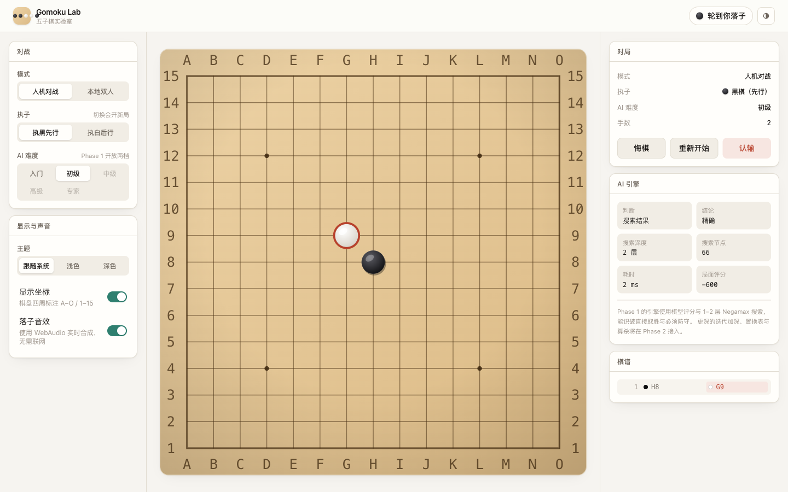
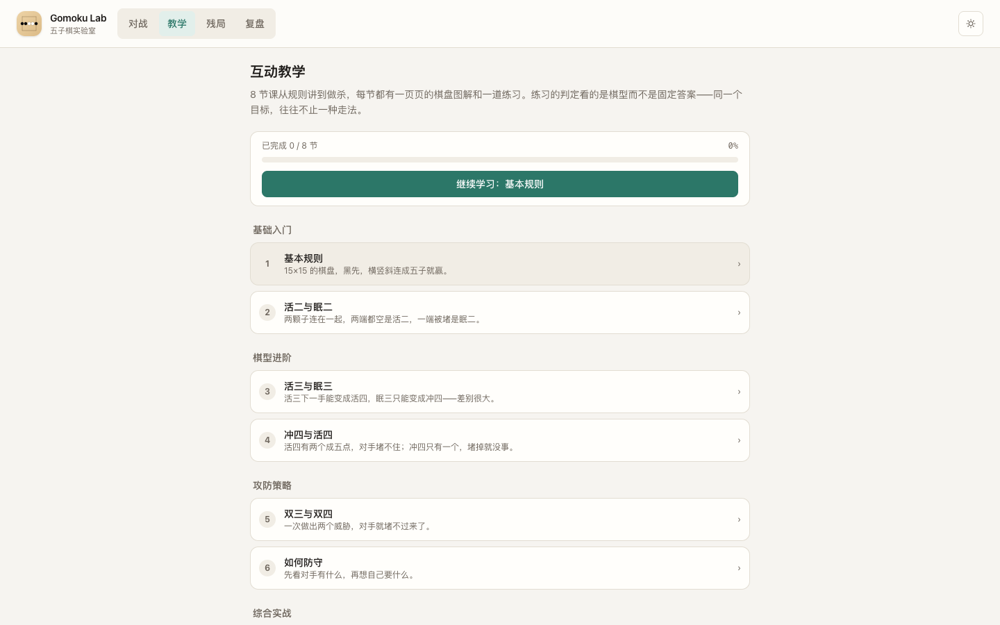
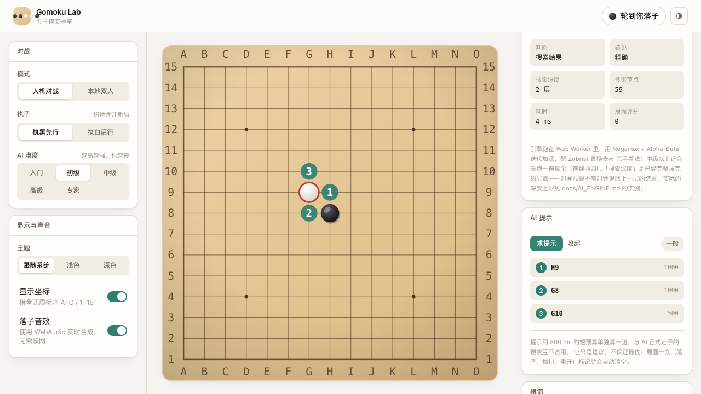
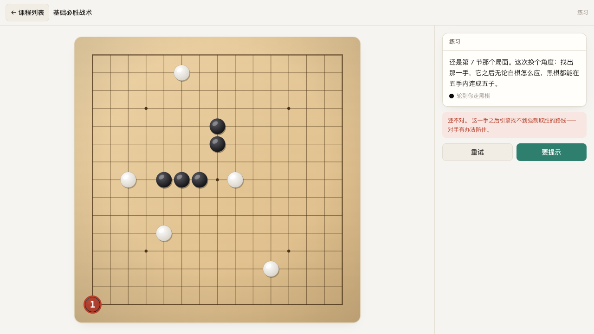
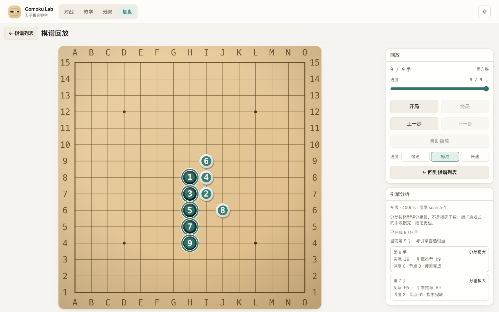
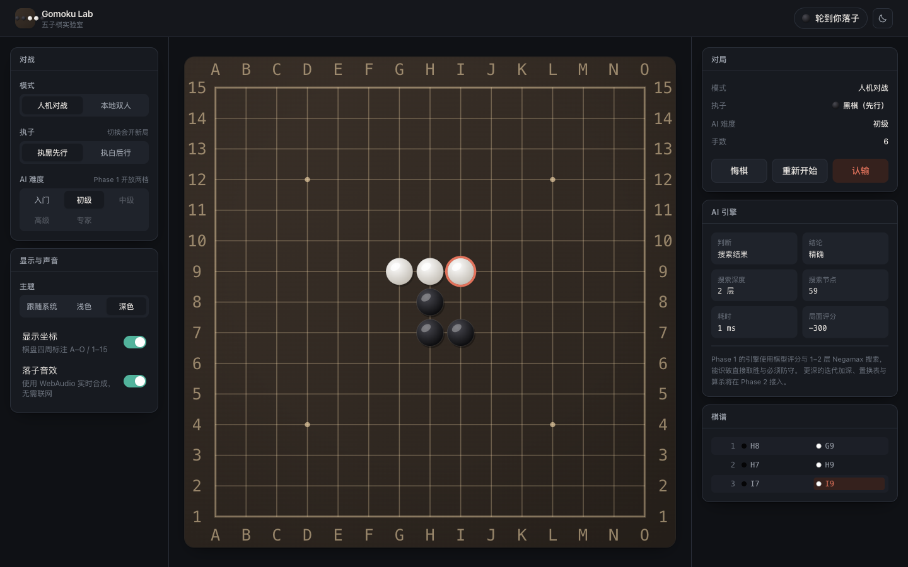
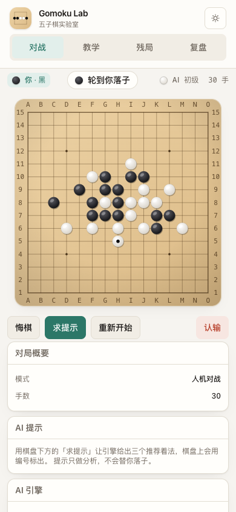

# Gomoku Lab · 五子棋实验室

一款**完全离线**的五子棋 Web 应用：五档真实强度的 AI 对战、提示、互动教学、残局挑战与对局复盘。
无后端、无账号、无云数据库、不调用任何第三方大模型 API——规则与 AI 全部自研。

**当前进度：Phase 5（最终打磨）已完成，待整分支终审。** 五个阶段的能力全部落地：
键盘与读屏可用、平板与触屏专项验证过、生产构建有独立的冒烟通道、用法有[使用说明](docs/USAGE.md)。



## 快速开始

```bash
yarn install
yarn dev          # 开发服务器
```

打开终端里提示的地址即可开始对局。首次开局默认玩家执黑、AI 初级难度。
玩法、键位与常见问题见 **[docs/USAGE.md](docs/USAGE.md)**。

## 命令

| 命令 | 作用 |
| --- | --- |
| `yarn dev` | 启动开发服务器 |
| `yarn build` | 类型检查 + 生产构建，产物在 `dist/` |
| `yarn preview` | 预览生产构建 |
| `yarn typecheck` | 类型检查（应用代码 + E2E 代码 + 基准脚本） |
| `yarn test` | 单元 / 组件测试（Vitest） |
| `yarn test:watch` | 单元测试监听模式 |
| `yarn lint` | oxlint |
| `yarn e2e` | 端到端测试（Playwright + 本机 Chrome）：桌面 / 移动触屏 / 平板触屏 |
| `yarn e2e:prod` | 生产构建冒烟：自带一次 `yarn build`，跑在 `dist` 上 |
| `yarn bench` | 引擎基准（约一两分钟），数字见 [docs/AI_ENGINE.md](docs/AI_ENGINE.md) 的「实测」 |
| `yarn bench:render` | 首屏与落子成本的浏览器实测，数字见 [docs/TEST_REPORT.md](docs/TEST_REPORT.md) |

提交前的完整清单见 [AGENTS.md](AGENTS.md)。



## 已实现的能力

**规则（`src/core`）**
15×15 自由规则：黑先，横竖斜任意方向连续五枚或更多即胜（长连有效、无禁手），棋子下满且无人成五判和。规则是零依赖的纯函数，与 React 完全分离。

**对战**
人机对战或本地双人、执黑或执白、**入门 / 初级 / 中级 / 高级 / 专家五档 AI**、悔棋、重新开始、认输、终局弹窗、棋谱记录、落子音效与胜负音、最后一步标记、坐标开关、浅色 / 深色 / 跟随系统。

五档的差异来自**真实的参数差异**（候选宽度、深度上限、时间预算、算杀开关），不是给同一套搜索贴标签；档位差异由自对弈测试守住。

**AI（`src/ai`）**
跑在 Web Worker 里，不阻塞主线程。棋型识别（窗口枚举，**能看见隔子型**）、候选点生成、Negamax + Alpha-Beta + 迭代加深、Zobrist 置换表、杀手着法、算杀搜索（连续冲四）、时间预算与超时回退。每个请求绑定棋局版本，过期响应一律丢弃。

**AI 提示**
用一段固定短预算单独算一遍，给出前三推荐着法与紧急程度（必胜 / 必须防守 / 危险 / 一般），棋盘上用 1/2/3 标出。提示走只分析请求：与 AI 正式走子共用引擎但互不挤占预算，**只写提示状态、绝不落子**。没搜完就如实标成「启发式」，不把猜测说成结论。



**互动教学与残局（`src/learn`）**
8 节课从规则讲到做杀，每节「讲解（带棋盘图解与可逐步播放的演示）→ 一道练习」。15 道残局题分六类（一步获胜 / 挡住直接胜着 / 构造活四 / 双重威胁 / 连续冲四 / 强制获胜路线）。

判定看的是**棋型而不是答案坐标**：题目只声明目标，判定用引擎自己的分析与算杀证明这一手是否达成。多解是自然结果，出题人没有机会把答案写错，提示与判定用的是同一把尺子。做错了给出算出来的理由，另有三级渐进提示。



**复盘（`src/features/review`）**
每局结束自动存入棋谱库（本机 IndexedDB），可逐手回放（编号徽标、自动播放）并让引擎逐手分析：分差、与引擎首选是否一致、几处最大亏损。结论区注明引擎版本、档位与预算。



**键盘与无障碍**
棋盘是一张 ARIA grid：单一 Tab 停靠点、方向键移动焦点、`Enter` / `空格` 落子，每格的可读名带坐标与状态。状态变化由**唯一一处** `aria-live` 播报（「AI 正在思考」「最后一手在 H8」……）。落子与面板动效在系统要求减少动态时自动关闭。见 [docs/ARCHITECTURE.md](docs/ARCHITECTURE.md)。

**错误边界与存档**
顶层错误边界兜住渲染异常，给一个说明与「重新加载」而不是白屏。每步自动存档，刷新即恢复；即使刷新时正轮到 AI，恢复后也会接着走完。存储不可用时（隐私模式等）整体降级为内存态。



## 技术栈

React 19 · TypeScript 6 · Vite 8 · Tailwind CSS 4 · Zustand 5 · Web Worker · IndexedDB · Vitest 5 · Playwright

动效用**纯 CSS**（`@keyframes` + `prefers-reduced-motion` 媒体查询），没有引入动画库——Phase 1 曾装过 `motion` 但全库零引用，属于提前引入，当时即移除；Phase 5 做完动效也没有装回来。

## 部署

纯静态产物，任何静态托管都能放：

```bash
yarn build                 # 产物在 dist/
```

部署到**子路径**时带上 `VITE_BASE`（末尾要有斜杠）：

```bash
VITE_BASE=/gomoku/ yarn build
```

产物的资源路径（含 Worker 的 chunk）都会带上该前缀，可以这样核对：

```bash
grep -o 'src="[^"]*"' dist/index.html          # 应看到 /gomoku/assets/...
grep -o '/gomoku/assets/worker-[^`]*' dist/assets/index-*.js
```

应用不含任何网络请求，也没有跨域与后端依赖。

## 目录结构

```
src/
├─ core/       纯规则与对局状态机（零 React、零 DOM）
├─ ai/         棋型、评估、搜索与 Worker 适配
├─ learn/      课程与题库：目标判定、求解与提示（纯逻辑）
├─ store/      Zustand 状态（对局 / 设置 / 回放 / 分析）
├─ persist/    存档与棋谱（IndexedDB，含降级）
├─ lib/        主题、音效、动效类名、坐标格式化等无状态工具
├─ components/ 展示层（棋盘 / 面板 / 原子组件 / 错误边界）
└─ features/   按功能组织的容器组件（对战 / 教学 / 残局 / 复盘）

docs/          架构、规则、AI、路线图、测试报告、使用说明与截图
e2e/           Playwright 端到端测试（桌面 / 移动 / 平板 / 生产构建）
bench/         引擎基准与渲染探针（不进常规测试套件）
```

## 测试与实测

| 项 | 数量 |
| --- | --- |
| 单元 / 组件用例 | **805**（45 个文件） |
| 端到端用例 | **46**（桌面 32 + 移动触屏 7 + 平板触屏 7） |
| 生产构建冒烟 | 5（`yarn e2e:prod`） |

关键实现都有反向验证记录（改坏实现确认用例会红），详见 [docs/TEST_REPORT.md](docs/TEST_REPORT.md)。
性能数字全部可复跑：`yarn bench`（引擎）与 `yarn bench:render`（首屏 352 ms、落子一手 0.30 ms 中位）。

## 已知限制

如实列出，不粉饰：

- **无禁手**：自由规则，长连也算胜。不做连珠式的三三 / 四四 / 长连禁手。
- **算杀只用 VCF**：VCT（含活三的算杀）实现与测试都在，但实测代价是 VCF 的 38–520 倍，故默认关闭——这是一处**有意的漏杀**。
- **专家档不保证搜到底**：深度上限 8 层在构造基准上从未达到（最多 6），真实对局中观察到 7 层。难度来自预算，不是承诺。
- **分析缓存只在复盘页打开期间有效**：缓存随页面的 store 创建，离开即失效；来回翻看同一局会重跑（9 手约 4 秒）。
- **分析固定用「初级」档 + 400ms 预算**，结论区标注了这一点；没有「深挖某一手」的入口。
- **满盘和棋的末手不参与分析**：那一手之后已无棋可走，没有可比的首选着法，直接跳过而不是编造结论。
- **Worker 无降级路径**：极老的浏览器不支持 module worker 时无法运行 AI（其余功能不受影响）。
- **基准不做断言**：`yarn bench` 只产数字、不设阈值；防性能回退目前靠人工比对。

## 文档

- [docs/USAGE.md](docs/USAGE.md) —— 玩法、键位与常见问题
- [docs/ARCHITECTURE.md](docs/ARCHITECTURE.md) —— 分层、数据流与接口契约
- [docs/RULES.md](docs/RULES.md) —— 规则定义与边界情形
- [docs/AI_ENGINE.md](docs/AI_ENGINE.md) —— 引擎原理、难度参数与已知局限
- [docs/ROADMAP.md](docs/ROADMAP.md) —— 五个阶段的进度与下一步
- [docs/TEST_REPORT.md](docs/TEST_REPORT.md) —— 测试覆盖、浏览器验证与性能实测
- [AGENTS.md](AGENTS.md) —— 参与开发前的约定

## 移动端


